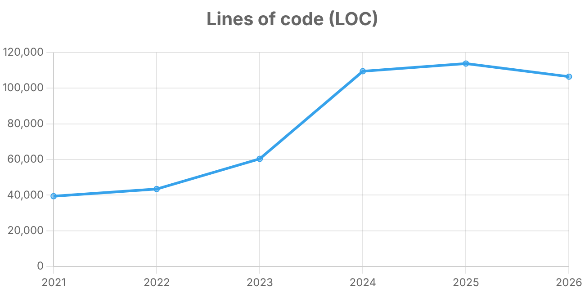

# Explorando evolução de código

Neste exercício, iremos explorar a evolução de código em sistemas reais.

Iremos utilizar a ferramenta [GitEvo](https://github.com/andrehora/gitevo).
Essa ferramenta analisa a evolução de código em repositórios Git nas linguagens Python, JavaScript, TypeScript e Java, e gera relatórios `HTML` como [este](https://andrehora.github.io/gitevo-examples/python/pandas.html).

Mais exemplos de relatórios podem ser podem ser encontrados em https://github.com/andrehora/gitevo-examples.

# Passo 1: Selecionar repositório a ser analisado

Selecione um repositório relevante na linguagem de sua preferência (Python, JavaScript, TypeScript ou Java).
Você pode encontrar projetos interessantes nos links abaixo:

- Python: https://github.com/topics/python?l=python
- JavaScript: https://github.com/topics/javascript?l=javascript
- TypeScript: https://github.com/topics/typescript?l=typescript
- Java: https://github.com/topics/java?l=java

# Passo 2: Instalar e rodar a ferramenta GitEvo

> [!NOTE]
> Antes de instalar a ferramenta, é recomendado criar e ativar um [ambiente virtual Python](https://packaging.python.org/en/latest/guides/installing-using-pip-and-virtual-environments/#create-and-use-virtual-environments).

Instale a ferramenta [GitEvo](https://github.com/andrehora/gitevo) com o comando:

```
$ pip install gitevo
```

Execute a ferramenta no repositório selecionado utilizando o comando abaixo (ajuste conforme a linguagem do repositório).
Substitua `<git_url>` pela URL do repositório que será analisado:

```shell
# Python
$ gitevo -r python <git_url>

# JavaScript
$ gitevo -r javascript <git_url>

# TypeScript
$ gitevo -r typescript <git_url>

# Java
$ gitevo -r java <git_url>
```

Por exemplo, para analisar o projeto Flask escrito em Python:

```
$ gitevo -r python https://github.com/pallets/flask
```

> [!NOTE]
> Essa etapa pode demorar alguns minutos pois o projeto será clonado e analisado localmente.

# Passo 3: Explorar o relatório de evolução de código

Após executar a ferramenta [GitEvo](https://github.com/andrehora/gitevo), é gerado um relatório `HTML` contendo diversos gráficos sobre a evolução do código.

Abra o relatório `HTML` e observe com atenção os gráficos.

# Passo 4: Explicar um gráfico de evolução de código

Selecione um dos gráficos de evolução e explique-o com suas palavras.
Por exemplo, você pode:

- Detalhar a evolução ao longo do tempo
- Detalhar se as curvas estão de acordo com boas práticas
- Explicar grandes alterações nas curvas
- Explorar a documentação do repositório em busca de explicações para grandes alterações
- etc.

Seja criativo!

# Instruções para o exercício

1. Crie um `fork` deste repositório (mais informações sobre forks [aqui](https://docs.github.com/pt/pull-requests/collaborating-with-pull-requests/working-with-forks/fork-a-repo)).
2. Adicione o relatório `HTML` no seu fork.
3. No Moodle, submeta apenas a URL do seu `fork`.

Responda às questões abaixo diretamente neste arquivo `README.md` do seu fork:

1. Repositório selecionado: https://github.com/fastapi/fastapi
2. Gráfico selecionado: 
3. Explicação: 

O gráfico mostra a evolução das linhas de código (LOC) do FastAPI entre 2021 e 2026,
com um snapshot por ano. Entre 2021 e 2023 o crescimento é moderado (de ~39 mil para
~60 mil LOC). Entre o snapshot de janeiro de 2023 e o de janeiro de 2024, porém, o LOC
quase dobra, chegando a ~109 mil, e o número de arquivos Python passa de 808 para 1.203.

Analisando o repositório, esse salto não vem do código do framework em si: o pacote
`fastapi/` se manteve praticamente estável, com cerca de 42 arquivos no período. O
crescimento está concentrado nos diretórios `docs_src/` (exemplos de código usados na
documentação, que foi de 400 para 635 arquivos) e `tests/` (de 360 para 516), que testa
esses exemplos.

A causa está em uma mudança de API feita em 2023: o FastAPI passou a suportar
`Annotated` (PEP 593) para declarar parâmetros e dependências
([PR #4871](https://github.com/fastapi/fastapi/pull/4871)), e em seguida toda a
documentação foi atualizada para recomendar esse novo estilo
([PR #9268](https://github.com/fastapi/fastapi/pull/9268)). Como a documentação precisava
continuar válida para várias versões do Python, cada exemplo ganhou variantes
(`*_an.py`, `*_an_py39.py`, `*_an_py310.py`), cada uma acompanhada de testes. Só os
arquivos com `_an` em `docs_src/` passaram de 4 para 211.

Entre 2024 e 2025 o crescimento desacelera, e em 2026 há uma leve queda (~114 mil para
~106 mil LOC). Uma hipótese é a remoção de variantes de exemplos ligadas a versões
antigas do Python, já que o número de arquivos `_an` diminui no mesmo período.

A principal conclusão é que LOC, sozinha, pode ser uma métrica enganosa: um salto grande
não significa necessariamente que o software ficou mais complexo. No caso do FastAPI,
o crescimento reflete um investimento em documentação e testes, o que é uma boa prática
para um framework cujo principal diferencial é a facilidade de uso.


